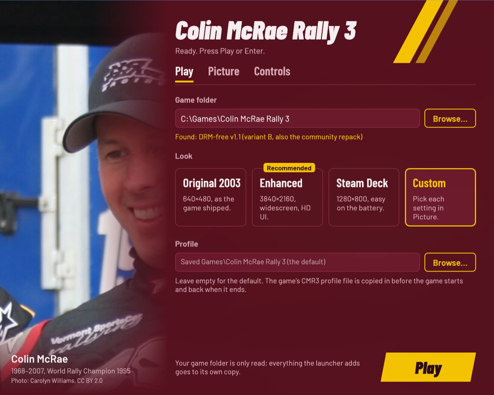
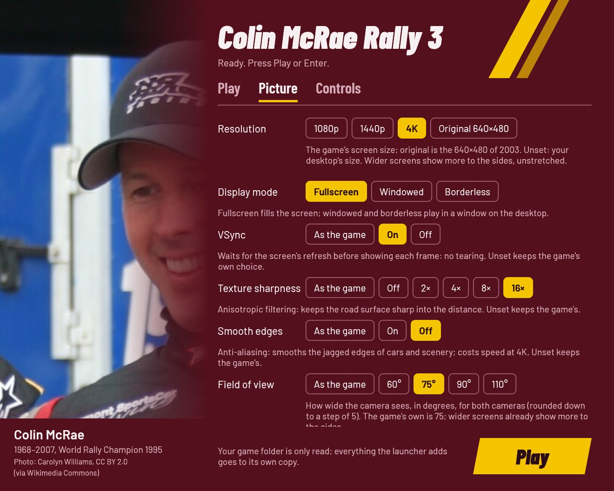
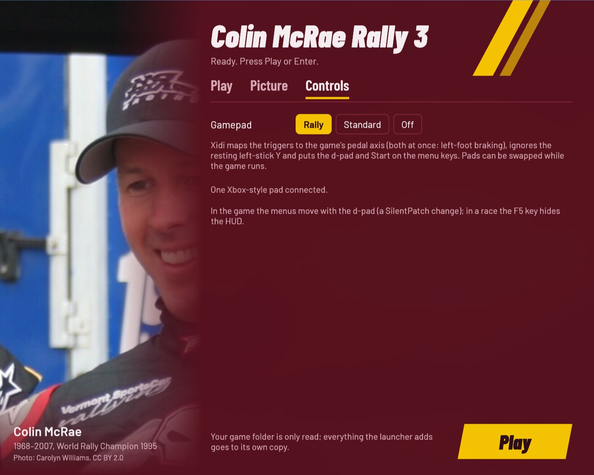

# Colin McRae Rally 3 Launcher

Play **your own copy** of the 2003 PC game Colin McRae Rally 3 on Windows
10/11, the Steam Deck and Linux (Proton, Wine or the AppImage). Point the
launcher at your installed game and press **Play**. The disc-protection
removal, widescreen, the 4K interface, the gamepad and the Vulkan renderer
are bundled and set up for you, with no mods, patchers or settings to fix
by hand. Your game folder is only read, never changed: the launcher plays
from its own private copy.

This project contains no game files: you need your own copy of the game.

> **Work in progress.** The game has been played end to end on Linux,
> through Wine with gamescope and through the AppImage. Native Windows,
> the Steam Deck and Proton without `cmr3-play` are not tested yet. If you
> try one of them, please
> [report what happens](https://github.com/akitaonrails/rea-colin-mcrae-3/issues).

[](https://new-uploads-akitaonrails.s3.us-east-2.amazonaws.com/2026/11/02/rea-colin-mcrae-3-demo-v012.mp4)

*A stage on Linux through the AppImage, with the Cinematic look. Click to
watch (1:56, with sound).*

## Problems this launcher solves

What goes wrong when you install the 2003 game on a computer today, and
what the launcher does about it:

| Problem | What the launcher does |
| --- | --- |
| The game won't start on Windows 10/11: Windows has blocked its SecuROM/SafeDisc disc protection since 2015, and Wine can't run it either. | Converts your official 1.1 executable into the DRM-free one the publisher's later re-releases shipped, with the SilentPatch project's patches. |
| A stretched 4:3 picture, a short list of resolutions, and an interface laid out for 640×480. | Any resolution and aspect ratio. A 16:9 screen shows more to the sides, unstretched, and the interface is moved into place for wide screens (SilentPatch, bundled). |
| A tiny, blurry interface at 4K. | Bekoha's HD UI: fonts, menus and race graphics redrawn for 4K, in every language the game has. |
| Rendering bugs on modern graphics cards and CPUs: a flickering sun that hitches with anti-aliasing, broken water reflections, split-screen and timing faults on multi-core CPUs. | Fixed by SilentPatch. Sharper car shadows and 16× texture filtering come with the modern look. |
| Modern pads barely work: through DirectInput both triggers share one axis (no left-foot braking), a new profile has no controller chosen, the default bindings put steering on the right stick, and the menus ignore the pad. | Xidi turns the pad into a proper game controller. New profiles start with the pad chosen, steering on the left stick and the pedals on the triggers (both at once), and the d-pad and A work the menus. |
| Under Wine or Proton the game crawls at 4K (about 10 FPS) through Wine's OpenGL translator. | DXVK draws it through Vulkan, at full speed. On Windows the system's own Direct3D is used. |
| Under Wine, fullscreen opens on the wrong monitor or comes out cropped. | gamescope gives the game a screen of its own; without it, the game plays borderless. |
| Under Wine, a fault in Wine's video playback froze the game behind a hidden debugger, so it couldn't even quit. | The debugger and its crash dialog are off, so the game ends cleanly instead. |
| A flat, washed-out picture with grey blacks. | On Linux, the Colour and Cinematic post-processing restores real blacks and contrast. |
| Patching the game folder risks the copy you own. | Your folder is only read; the launcher works on its own private copy, and your profile lives in a folder you choose. |

## Screenshots

| Play | Picture | Controls |
| --- | --- | --- |
|  |  |  |


## What you need

**Colin McRae Rally 3 for Windows PC, installed and updated to the
official 1.1 patch.** The folder holds `Rally_3PC.exe` next to `Data`,
`fonts` and `shaders`.

- Original CDs, a backup of an installed game, or a digital re-release all
  work. If your copy is still 1.0, install the official 1.1 patch first
  ([download on PCGamingWiki](https://community.pcgamingwiki.com/files/file/2506-colin-mcrae-rally-3-patch/)).
- The DRM-free re-releases (the Polish eXtra Klasyka 2-CD, the German DVD)
  are already 1.1 and DRM-free.
- The launcher removes the disc protection from an official 1.1
  executable by itself. It does not crack anything else, and it can't run
  v1.0.

The launcher knows each supported `Rally_3PC.exe` by its fingerprint
(SHA-256). Another version is refused with its code and a link to the
[unknown version](https://github.com/akitaonrails/rea-colin-mcrae-3/issues/new?template=unknown-edition.yml)
form, so it can be added. Report the code, never the game's files.

## Download and install

Download from the
[latest release](https://github.com/akitaonrails/rea-colin-mcrae-3/releases/latest):

- **Windows, Steam Deck and Proton:** `CMR3Launcher-<version>.zip`
- **Linux:** `CMR3Launcher-<version>-x86_64.AppImage`

The zip holds `CMR3Launcher.exe`, its `thirdparty/` folder (SilentPatch,
Xidi, the DRM-free patcher, DXVK and the HD UI) and `linux/` (`cmr3-play`,
the Linux helper). Keep `thirdparty/` next to the launcher.

### Windows

1. Unzip `CMR3Launcher-<version>.zip` anywhere, for example into your
   game folder. Keep its folders next to `CMR3Launcher.exe`.
2. Run `CMR3Launcher.exe` and follow [First run](#first-run). The
   launcher is not signed, so the first start from a downloaded zip may
   show "Windows protected your PC": choose *More info*, then *Run
   anyway*.

### Steam Deck

1. In Desktop Mode, unzip the release, then in Steam choose *Games → Add a
   Non-Steam Game to My Library…* and pick `CMR3Launcher.exe`.
2. In its *Properties → Compatibility*, force a Proton version.
3. Back in Game Mode, start it: the window works with the controls and
   recommends the **Steam Deck** look.

Game Mode has not been tested on a Deck yet.

### Linux: AppImage

```sh
chmod +x CMR3Launcher-*-x86_64.AppImage
./CMR3Launcher-*-x86_64.AppImage
```

It brings its own Wine, so nothing else needs to be installed. It keeps
its Wine prefix in `~/.local/share/cmr3-launcher/prefix` and runs the game
in [gamescope](https://github.com/ValveSoftware/gamescope) when it is
installed.

### Linux: Steam (Proton)

Unzip the release, add `CMR3Launcher.exe` as a non-Steam game and force a
Proton version in its compatibility settings, as on the Steam Deck.
Proton brings its own DXVK and runs without `cmr3-play`, so the Linux-only
rows (upscaling, post-processing) don't apply there.

### Linux: your own Wine

Run `linux/cmr3-play` from the unzipped release:

```sh
linux/cmr3-play            # the settings window, then the game
linux/cmr3-play --play     # the game with the saved settings, no window
linux/cmr3-play stop       # end the game
linux/cmr3-play status     # running or idle
```

It needs Wine; gamescope is optional but recommended. Options, a distrobox
and more: [linux/README.md](linux/README.md).

## First run

1. In the window's **Play** tab, press **Browse…** and choose the folder
   with `Rally_3PC.exe`. Under Wine your Linux files are on drive `Z:`,
   for example `Z:\home\you\Games\Colin McRae Rally 3`. The window says
   what it found.
2. Pick a look: **Enhanced** suits most screens and is picked the first
   time (on a Steam Deck, **Steam Deck**).
3. Press **Play** (or Enter, or Start on a gamepad).

The first start copies the game into the launcher's private folder (about
3 GB). That is almost instant when your game folder and the launcher's
folder are on the same disk, because the big data files are hard-linked.
Later starts copy only what changed. Your choices are remembered.

## The settings window

The window is the same on Windows and Linux, and larger on big screens.
Every control has a line under it saying what it changes.

- **Play:** the game folder, the look, and the folder that keeps your
  profile.
- **Picture:** resolution, display mode, vsync, texture sharpness, smooth
  edges, field of view, car shadows and the HD menus. On Linux also
  Vulkan (DXVK), gamescope's upscaling and post-processing.
- **Controls:** the gamepad preset, how many pads are connected, and the
  gamepad log for bug reports.

| Look | What it sets | When to pick it |
| --- | --- | --- |
| **Original 2003** | 640×480, everything else as the game shipped | To play it as in 2003 |
| **Enhanced** | Your screen's size, widescreen, vsync, 16× texture filtering, the HD menus | Most screens (picked on the first run) |
| **Steam Deck** | 1280×800, vsync, 16× texture filtering, the HD menus | The Steam Deck (picked on a Deck) |
| **Custom** | Any change in the Picture tab | |

The window works with a gamepad (d-pad moves, A changes the focused
setting, LB/RB switch tabs, Start plays) and with the keyboard alone (Tab
moves, arrows pick, Ctrl+Tab switches tabs, Enter plays). A control that
can't be used right now is greyed out and says why.

## Gamepad

Pick the **Rally** preset (the default) and play.

| On the pad | In menus | In a race |
| --- | --- | --- |
| Left stick | | Steer |
| Right trigger / left trigger | | Throttle / brake (both at once for left-foot braking) |
| D-pad | Move | |
| A | Select | |

Xidi (bundled) makes a modern XInput pad a game controller, and resting
thumbs can't open the throttle. You can swap pads while the game runs. The
game's menus answer only the keyboard, so the d-pad and A also press the
arrow keys and Enter.

- A new profile starts with the pad as its controller and vibration at
  Medium. A profile from an earlier install that points at the keyboard
  keeps it: choose the Xidi controller once in the game's Options →
  Controls.
- Under Steam the Deck's controls arrive as an Xbox-style pad; on 8BitDo
  pads use X-input mode.
- If you prefer the game's own handling, set the gamepad to **Standard**
  (then bind the pedals to the left stick's Y axis in the game's control
  setup) or **Off**.

## Options

Every option has the same name in the window, in `launcher.cfg` (with
underscores) and on the command line (with hyphens); `CMR3Launcher.exe
--help` lists them. The first run writes a commented `launcher.cfg`
([Where things live](#where-things-live)).

| `launcher.cfg` / flag | In the window | Values | Unset | What it changes |
| --- | --- | --- | --- | --- |
| `game` / `--game` | Play: Game folder | a folder | found next to the launcher | The folder with your `Rally_3PC.exe`; only read. Remembered. |
| `saves` / `--saves` | Play: Profile folder | a folder | `Saved Games\Colin McRae Rally 3` | Where your profile (the game's `CMR3` file) is kept. |
| `runtime` / `--runtime` | — (file and flag only) | a folder | `%LOCALAPPDATA%\CMR3Launcher\Rally3` | Where the launcher's private copy goes (about 3 GB). |
| `look` / `--look` | Play: Look | `original`, `enhanced`, `steam_deck` | the picture values saved | Every picture setting at once, as the window's look cards set them. Picture options given on their own win over it. The window saves the values themselves. |
| `resolution` / `--resolution` | Picture: Resolution | `WIDTHxHEIGHT`, `original` | the desktop's size | Any size and aspect ratio; `original` is the 640×480 of 2003. |
| `display_mode` / `--display-mode` | Picture: Display mode | `fullscreen`, `windowed`, `borderless` | fullscreen | Fullscreen plays borderless under Wine without gamescope. |
| `vsync` / `--vsync` | Picture: VSync | `on`, `off` | the game's (Enhanced: on) | Waits for the screen's refresh: no tearing. |
| `anisotropic` / `--anisotropic` | Picture: Texture sharpness | `off`, `2`, `4`, `8`, `16` | the game's (Enhanced: 16) | Keeps the road sharp into the distance. |
| `fsaa` / `--fsaa` | Picture: Smooth edges | `on`, `off` | the game's (Enhanced: off) | Anti-aliasing (SilentPatch fixes its rendering bugs); costs speed at 4K. |
| `fov` / `--fov` | Picture: Field of view | 30–150, steps of 5 | the game's (75) | How wide both cameras see. |
| `shadows` / `--shadows` | Picture: Car shadows | `sharp`, `soft` | the game's | Sharp is the 2005 look, soft the blur of 2003. |
| `hd_ui` / `--hd-ui` | Picture: HD menus | `on`, `off` | off (Enhanced: on) | Bekoha's 4K interface. |
| `dxvk` / `--dxvk` | Picture: Vulkan (DXVK), Linux only | `on`, `off` | on | Draws through Vulkan instead of Wine's OpenGL translator. Ignored on Windows. |
| `scaler` / `--scaler` | Picture: Upscaling, Linux only | `nearest`, `pixel`, `fsr`, `linear` | `linear` | How gamescope enlarges the picture. Read by `cmr3-play`. |
| `postfx` / `--postfx` | Picture: Post-processing, Linux only | `off`, `color`, `cinematic` | off | A colour grade over the finished frame: `color` gives real blacks, fuller contrast and sharpening, `cinematic` a stronger grade (ambient occlusion only if you add the MxAO shader, see [docs/ENHANCEMENTS.md](docs/ENHANCEMENTS.md)). Needs DXVK. Read by `cmr3-play`. |
| `gamepad` / `--gamepad` | Controls: Gamepad | `rally`, `standard`, `off` | `rally` | Rally: the triggers are the pedals and the d-pad and A work the menus. Standard: the pad as it reports itself. Off: no Xidi. |
| `gamepad_log` / `--gamepad-log` | Controls: Gamepad log | `on`, `off` | off | Xidi logs what the game asks and what each control sent, for bug reports. |

Unset means the game keeps its own value; a value you set and later unset
goes back to the game's, unless you changed it in the game since.

Any option on the command line skips the window and plays; options
override `launcher.cfg` for that run only (with `cmr3-play --play …` too,
the gamescope ones included), and only `--game` is remembered. The
launcher's own switches:

- `--no-window`: play with the saved settings, no window.
- `--check`: check a game folder, its executable (with its SHA-256) and
  the bundled parts without playing. An official 1.1 executable with disc
  protection is tried with the bundled patcher on a scratch copy and
  reported as "converted at Play"; the HD UI is optional. The report goes
  to the terminal and `launcher.log` (exit 0 ready, 1 something needed is
  missing or unknown).
- `--settings`: only the settings window (exit 0 Play pressed, 3 closed
  without Play, 4 no window possible).
- `--linux`: started by `cmr3-play` or the AppImage.
- `--help`: every option and its values.

A bad flag or value exits with 2 and a message naming what it takes.

One launcher runs at a time. Starting it again while its window is open
brings the window to the front (exit 0). While the game runs, a second
start says so and exits 5, and so does Play when the game is still
running from the launcher's private copy (a launcher that was ended while
playing, say). `--check` with the window open says to use the window
and exits 5 too.

## Where things live

| What | Windows | Linux (AppImage, `cmr3-play`) |
| --- | --- | --- |
| Settings (`launcher.cfg`) and log (`launcher.log`) | `%LOCALAPPDATA%\CMR3Launcher\` | in the Wine prefix, `drive_c/users/<you>/AppData/Local/CMR3Launcher/` |
| The launcher's copy of the game | `%LOCALAPPDATA%\CMR3Launcher\Rally3` (the `runtime` option moves it) | the same folder inside the prefix |
| Your profile (saves) | `%USERPROFILE%\Saved Games\Colin McRae Rally 3` (or your `saves` folder) | in the prefix, `drive_c/users/<you>/Saved Games/Colin McRae Rally 3` |
| Wine prefix | — | `~/.local/share/cmr3-launcher/prefix` |
| `cmr3-play`'s logs (`play.log`, `settings.log`) and lock | — | `~/.config/cmr3-launcher` |
| Graphics preference (registry) | `HKCU\Software\Microsoft\DirectX\UserGpuPreferences`, value named after the copy's `Rally_3PC.exe` (`GpuPreference=2;`, the high-performance GPU) | — |
| Wine DLL overrides (registry, in the prefix) | — | `HKCU\Software\Wine\AppDefaults\Rally_3PC.exe\DllOverrides` (`dsound`, `dinput8`, `d3d9`), and the launcher's record of the ones it wrote in `HKCU\Software\rea-launcher\DllOverrides\Rally_3PC.exe` |
| Wine's OpenGL setting (registry, in the prefix) | — | `HKCU\Software\Wine\X11 Driver`, `UseEGL=N` (the settings window draws through GLX) |

A `launcher.cfg` next to `CMR3Launcher.exe` is used instead (a portable
install). Under Proton everything is inside Steam's prefix for the
non-Steam game
(`~/.steam/steam/steamapps/compatdata/<id>/pfx/drive_c/users/steamuser/…`).

The game reads and writes its profile (`CMR3`) in the launcher's copy. The
launcher copies it in from your profile folder before the game starts and
back when it ends, so your progress lives in the profile folder. On
Windows the launcher also sets the game's graphics preference to the
high-performance GPU (the registry value in the table).

## Troubleshooting

- **"This Rally_3PC.exe is not a version the launcher knows"**: your
  executable is neither a DRM-free 1.1 build nor an official 1.1 one the
  bundled patcher converts (an unofficial no-CD, or still v1.0).
  Re-install the official 1.1 patch and try again. If it is a 1.1 build
  anyway, open the
  [unknown version](https://github.com/akitaonrails/rea-colin-mcrae-3/issues/new?template=unknown-edition.yml)
  form with the code the message shows and where your copy comes from.
- **The game crawls at 4K under Wine**: DXVK is off. Turn it on in the
  settings window (Linux), or check that `thirdparty/dxvk/d3d9.dll` is
  next to the launcher.
- **The pad has no throttle**: use the Rally preset, and leave the game's
  accelerator and brake on the left stick's Y axis.
- **Anything else:** run `CMR3Launcher.exe --check`, then open a
  [bug report](https://github.com/akitaonrails/rea-colin-mcrae-3/issues/new?template=bug-report.yml)
  with `launcher.log` attached (remove personal paths). Never attach game
  files.

## Known limitations

- The interface languages come with your copy of the game. To use every
  language and co-driver together, add SilentPatch's Language Pack to
  your **game** folder yourself (we don't redistribute game content); the
  launcher picks the rest up from there.
- Only the official 1.1 executables (and the DRM-free ones) are
  supported; v1.0 needs the official patch first.
- Post-processing is Linux only (`cmr3-play` with DXVK).
- Not yet tested on native Windows, a Steam Deck, or Proton without
  `cmr3-play`; the full list of what was and wasn't checked is in
  [docs/RUNTIME_NOTES.md](docs/RUNTIME_NOTES.md#platform-matrix).

## Uninstall

1. **Back up your profile first:** `%USERPROFILE%\Saved Games\Colin McRae
   Rally 3` (or your `saves` folder) holds your progress. On Linux it is
   inside the Wine prefix (see [Where things live](#where-things-live)),
   so deleting the prefix in step 4 deletes it too.
2. Delete the folder you unzipped the launcher into (or the AppImage).
3. Windows: delete `%LOCALAPPDATA%\CMR3Launcher` (settings, log and the
   launcher's ~3 GB copy of the game). The graphics preference in
   `HKCU\Software\Microsoft\DirectX\UserGpuPreferences` names the copy's
   `Rally_3PC.exe`; you can delete that value too. Nothing else goes in
   the Windows registry.
4. Linux: copy your profile out of the prefix, then delete
   `~/.local/share/cmr3-launcher` and `~/.config/cmr3-launcher`. The
   Wine registry entries (DLL overrides, `UseEGL`) live in the prefix
   and go with it; with your own Wine prefix, delete
   `HKCU\Software\Wine\AppDefaults\Rally_3PC.exe`,
   `HKCU\Software\rea-launcher\DllOverrides\Rally_3PC.exe` and, if
   nothing else needs it, the `UseEGL` value with `wine regedit`. With
   Proton, removing the shortcut in Steam offers to delete its prefix,
   saves included.

Your game folder was never changed, so there is nothing to undo there.

## For developers

Rust (edition 2024), MinGW-w64 with lld for the `i686-pc-windows-gnu`
target, Wine for the Windows-target tests and `cargo-deny`. The
[`gaming` distrobox](https://github.com/akitaonrails/distrobox-gaming) has
them all; run the last two commands there with an absolute path. lld is
required: GNU ld 2.47 leaves some of the launcher's imports unresolved
(`.cargo/config.toml`).

```sh
cargo fmt --all --check
cargo test --workspace --locked                 # host tests, the settings window headless
cargo clippy --release --target i686-pc-windows-gnu --workspace --all-targets -- -D warnings
cargo deny check
for t in linux/tests/*.sh packaging/tests/*.sh; do sh "$t"; done   # e2e.sh runs the game only with CMR3_E2E=1
sh <sdk>/scripts/sdk-sync --check .             # sdk/ matches the pinned SDK tag
cargo build --release --locked --target i686-pc-windows-gnu
sdk/scripts/wine-test --locked --workspace      # Windows-target tests under Wine, headless
```

- New SDK release: `sdk/scripts/sdk-bump vX.Y.Z` moves the Cargo tags,
  `sdk/` and the workflow pins together and prints the migration notes
  ([sdk/docs/playbooks/sdk-change.md](sdk/docs/playbooks/sdk-change.md)).
  A weekly workflow (`.github/workflows/sdk-update.yml`) opens that pull
  request.
- Free the disk space builds take: `sdk/scripts/clean` (a dry run), then
  `sdk/scripts/clean --yes`.
- Golden snapshots of `--help`, the `launcher.cfg` template and what each
  look writes are in `crates/cmr3-launcher/tests/snapshots/`. After an
  intended change, `CMR3_UPDATE_SNAPSHOTS=1 cargo test --test snapshots`,
  then review every diff.
- Real-game tests read your installed copy and never change it:
  `CMR3_SMOKE_GAME=<game folder> CMR3_SMOKE_BUNDLE=<thirdparty folder>
  cargo test --test smoke -- --ignored`.
- Third-party components are fetched at package time from pinned URLs
  with SHA-256 (`packaging/third-party.txt`); GitHub Actions (the SDK's
  reusable workflows) runs the checks, the Windows-target tests under
  Wine, builds the zip and the AppImage, and publishes a release for each
  `v*` tag.

Rules for contributors and coding agents: [AGENTS.md](AGENTS.md). Design
notes: [docs/PLAN.md](docs/PLAN.md); community fixes and decisions:
[docs/RESEARCH.md](docs/RESEARCH.md); what was verified in the real game:
[docs/RUNTIME_NOTES.md](docs/RUNTIME_NOTES.md); drafts for the community:
[docs/CONTRIBUTIONS.md](docs/CONTRIBUTIONS.md).

## How it works

When you press **Play**, the launcher:

1. checks `Rally_3PC.exe` against the builds it knows;
2. brings its private copy of the game up to date with your folder
   (hard links where it can);
3. turns an official 1.1 executable in that copy into the DRM-free one;
4. installs SilentPatch, Xidi, the HD UI and, under Wine, DXVK into the
   copy, and writes the settings it owns into `SilentPatchCMR3.ini`;
5. copies your profile in, starts the game and waits for it;
6. copies your profile back to your profile folder.

## Built on rea-launcher-sdk

The private copy of the game, profile mirroring, `launcher.cfg` and the
option table, the settings window's widgets, the Linux helper's library
(`rea-play.sh`), packaging and CI come from
[rea-launcher-sdk](https://github.com/akitaonrails/rea-launcher-sdk),
shared by every rea launcher. It is pinned by tag in `Cargo.toml` and
vendored in `sdk/` (the tag is in `sdk/VERSION`). This repository keeps
what is specific to Colin McRae Rally 3: the editions and the DRM-free
patcher, the SilentPatch keys, the Xidi presets, the HD UI, the looks,
`cmr3-play`'s settings and post-processing, and the package contents.

## Contributing

- **About Colin McRae Rally 3** (its versions, the SilentPatch, Xidi and
  DXVK settings, the profile, the HD UI, the looks, `cmr3-play`'s game
  settings and post-processing, packaging pins, this README): issues and
  pull requests here.
- **Shared code** (the private copy and its syncing, the settings window's
  widgets and theme, the option table, `rea-play.sh`, the packaging
  scripts and AppImage builder, CI workflows, anything under `sdk/`):
  issues and pull requests at
  [rea-launcher-sdk](https://github.com/akitaonrails/rea-launcher-sdk/issues).
- **How to tell:** code under `sdk/` or from a `rea_launcher*` crate is
  the SDK's; if the same problem would happen with another rea launcher,
  it's the SDK's. Not sure? Open it here and it will be moved.
- Never patch `sdk/` or copy SDK code here: fix the SDK and bump the tag.
- Never attach game files (executables, saves, data) to an issue.
- Test reports are welcome, especially from Windows and the Steam Deck:
  the [bug report](https://github.com/akitaonrails/rea-colin-mcrae-3/issues/new?template=bug-report.yml)
  form.

## Credits

- [SilentPatchCMR3](https://github.com/CookiePLMonster/SilentPatchCMR3) by
  CookiePLMonster: widescreen, display and compatibility fixes, and the
  DRM-free patcher's patches.
- [Ultimate ASI Loader](https://github.com/ThirteenAG/Ultimate-ASI-Loader)
  by ThirteenAG, shipped with SilentPatch: loads it into the game.
- [xdelta3](https://github.com/jmacd/xdelta-gpl) by jmacd: applies the
  DRM-free patches.
- [Bekoha's HD UI](https://bekoha.github.io/cmr3/): the 4K interface.
- [Xidi](https://github.com/samuelgr/Xidi) by samuelgr: the gamepad.
- [DXVK](https://github.com/doitsujin/dxvk) by doitsujin: Vulkan under
  Wine.
- [vkBasalt](https://github.com/DadSchoorse/vkBasalt) by DadSchoorse, with
  ReShade's FX compiler by Patrick Mours and stb by Sean Barrett:
  post-processing on Linux.
- [Wine](https://www.winehq.org/), in
  [Kron4ek's builds](https://github.com/Kron4ek/Wine-Builds), and the
  [AppImage](https://github.com/AppImage/type2-runtime) runtime and
  `appimagetool`: the Linux AppImage.
- The settings window's Colin McRae photo is by Carolyn Williams, CC BY
  2.0 (via Wikimedia Commons); its Barlow fonts are by Jeremy Tribby (SIL
  OFL).
- [PCGamingWiki](https://www.pcgamingwiki.com/wiki/Colin_McRae_Rally_3),
  ProtonDB and the WineHQ AppDB: where the fixes and Linux reports were
  found.
- [rea-launcher-sdk](https://github.com/akitaonrails/rea-launcher-sdk).

Full list with licences: [THIRD_PARTY.md](THIRD_PARTY.md).

## Legal

Colin McRae Rally 3 is © Codemasters. This project is not affiliated with
or endorsed by Codemasters or Electronic Arts, contains no game code or
assets, and only runs a copy you own. Our code is MIT or Apache-2.0
([LICENSE-MIT](LICENSE-MIT), [LICENSE-APACHE](LICENSE-APACHE)); bundled
third-party parts (SilentPatch, Xidi, DXVK, the DRM-free patcher, the HD
UI, Wine) keep their licences, listed in [THIRD_PARTY.md](THIRD_PARTY.md).
