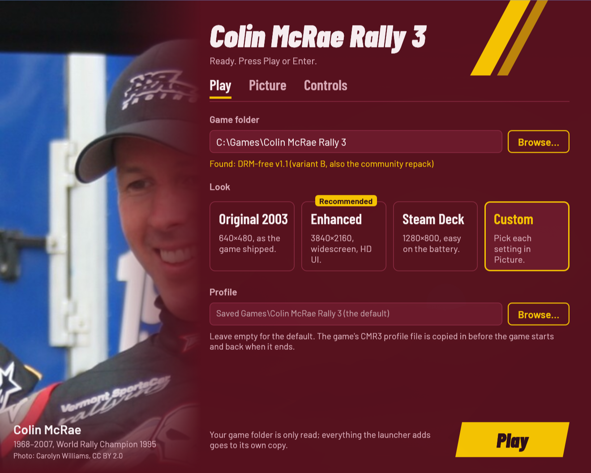
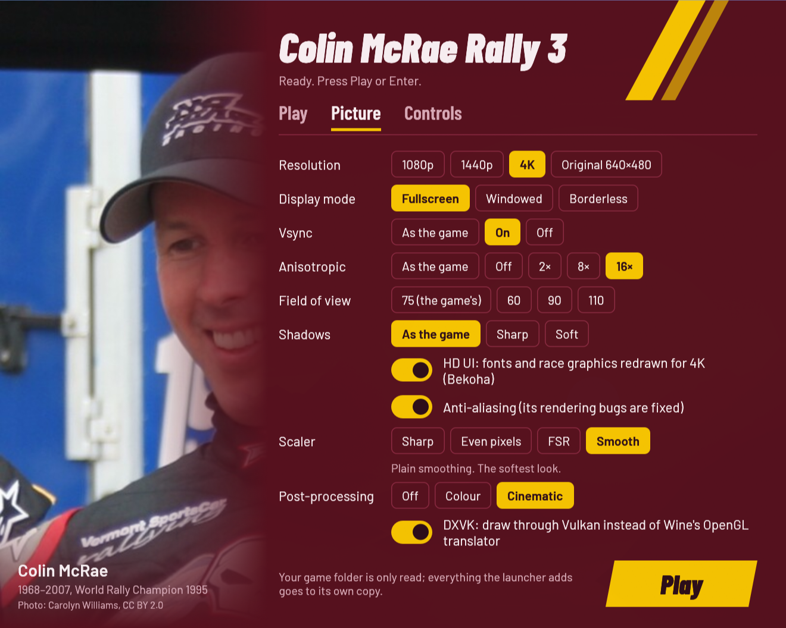
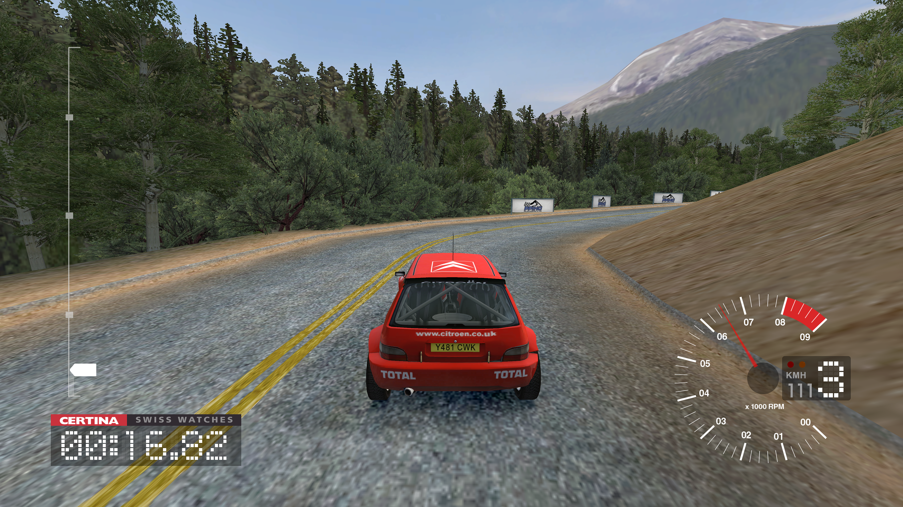

# Colin McRae Rally 3 — play it today

> **Work in progress.** The pieces it is built from (SilentPatch, Xidi,
> DXVK) are proven on this machine's gaming setup; the launcher itself is
> new and needs testing on real machines. Help is welcome, especially from
> **Windows** players: try it and
> [report what happens](https://github.com/akitaonrails/rea-colin-mcrae-3/issues).

Play your own copy of the 2003 PC game **Colin McRae Rally 3** on a modern
computer: Windows 10/11, or Linux through Steam (Proton), Wine or the
AppImage.

You point the launcher at your installed game and press **Play**. The rest
— disc-protection removal, widescreen, the 4K interface, the gamepad, the
Vulkan renderer — is bundled and configured for you. Your game folder is
never changed: the launcher works on its own private copy.

## The launcher

| Play | Picture | Controls |
| --- | --- | --- |
|  |  |  |

## What it adds to the original game

**Runs on today's computers**

- Converts an official 1.1 executable's disc protection (SecuROM/SafeDisc,
  disabled by Windows since 2015 and unsupported under Wine) to the
  DRM-free code the late re-releases shipped, using the SilentPatch
  project's xdelta updates.
- Every display resolution and **any aspect ratio**: 16:9 shows more to
  the sides, unstretched, with the whole interface repositioned for wide
  screens (all of this is SilentPatch, bundled).
- Fullscreen, windowed or borderless; vsync; your refresh rate.
- Under Wine or Proton, the game draws through **DXVK** (Vulkan): the
  difference between native speed and about 10 FPS at 4K. On Windows the
  system's own Direct3D is used.

**The 4K picture**

- The **HD UI** (by Bekoha): font atlases and race graphics redrawn for
  4K, for every language the game has.
- 16× anisotropic filtering by default, sharper car shadows, fixed water
  reflections, sun rendering that no longer flickers or hitches with
  anti-aliasing.
- Field-of-view control for the chase and interior cameras.



**Gamepads**

- **Xidi** (bundled) makes modern XInput pads work through the game's
  DirectInput, with a mapping validated on real hardware: the triggers
  are the pedals (both at once — left-foot braking), resting thumbs can't
  open the throttle, the d-pad and Start work the menus, and pads can be
  swapped while the game runs.
- In the menus, the d-pad navigates (a SilentPatch change from the
  console releases).

**Comfort**

- Your profile (the game's `CMR3` file with your progress) lives in a
  folder you choose, outside the game.
- Your game folder is never modified; a manifest keeps the launcher's
  copy up to date with what changed in yours.
- A settings window, the same on Windows and Linux (larger on big
  screens), with one-click looks (Original 2003, Enhanced, Steam Deck)
  and a commented settings file.

This project contains **no game files**. You need your own copy of the
game.

## 1. The game you need

**Colin McRae Rally 3 for Windows PC, installed and updated to the
official 1.1 patch.** The folder contains `Rally_3PC.exe` next to `Data`,
`fonts` and `shaders`.

- Original CDs, a backup of an installed game, or a digital re-release all
  work. **If your copy is still 1.0**, install the official 1.1 patch
  first ([download on PCGamingWiki](https://community.pcgamingwiki.com/files/file/2506-colin-mcrae-rally-3-patch/)).
- The DRM-free re-releases (the Polish eXtra Klasyka 2-CD, the German
  DVD) are already 1.1 and DRM-free.
- The launcher removes the disc protection from an official 1.1
  executable automatically. It does **not** crack anything else, and it
  cannot run v1.0.

## 2. Download

Download `CMR3Launcher-….zip` from the
[latest release](https://github.com/akitaonrails/rea-colin-mcrae-3/releases/latest)
and unpack it anywhere, for example into your game folder. It contains:

- `CMR3Launcher.exe` — the launcher
- `thirdparty/` — SilentPatch, Xidi, the DRM-free patcher, DXVK and the
  HD UI; keep it next to the launcher
- `linux/` — `cmr3-play`, the Linux helper for Wine and gamescope

On Linux without Steam you can instead download
`CMR3Launcher-…-x86_64.AppImage`, which brings its own Wine (see
[linux/README.md](linux/README.md)).

## 3. Play

1. Unpack the zip anywhere, for example into your game folder.
2. Double-click `CMR3Launcher.exe`. The settings window opens.
3. If the game folder is empty, press **Browse…** and pick the folder with
   your `Rally_3PC.exe`; the window shows what it found.
4. Choose a look: **Enhanced** (the first time's choice: your screen's
   size, widescreen, HD UI), **Steam Deck**, **Original 2003** or
   **Custom**, then press **Play** (or Enter, or Start on a gamepad).

The first start takes a moment while the launcher makes its private copy
of the game (about 3 GB — near-instant when your game folder and the
launcher's folder sit on one disk, because the big data files are
hard-linked). Your choices are remembered for next time.

On Linux, follow [linux/README.md](linux/README.md): the AppImage (no
Wine needed), Steam with Proton, or your own Wine with gamescope through
`linux/cmr3-play`.

## Settings

Everything is optional; the first run's Enhanced look gives you the
modern experience out of the box. The settings window covers all of it:
**Play** (the game folder, the look, your profile folder), **Picture**
and **Controls**. They are kept in `launcher.cfg`, which you can also
edit by hand. Starting `CMR3Launcher.exe` with any option (for example
`--resolution 1920x1080`) skips the window and plays straight away.

| Setting | What it does | Default |
| --- | --- | --- |
| `resolution = 3840x2160` | The display resolution, any aspect ratio. `original` is the 640×480 of 2003. | the desktop's size |
| `display_mode = fullscreen` | `fullscreen`, `windowed` or `borderless`. | fullscreen |
| `vsync = true` | Waits for the screen's refresh (no tearing). | on |
| `anisotropic = 16` | `off`, 2, 4, 8 or 16; sharpens the road at a distance. | 16 (Enhanced) |
| `fsaa = off` | Anti-aliasing (its rendering bugs are fixed by SilentPatch). | off |
| `fov = 75` | Field of view for both cameras, 30–150 in steps of 5. | 75 |
| `shadows = sharp` | `sharp` or `soft` car shadows; unset keeps the game's choice. | unset |
| `hd_ui = on` | The 4K interface pack. | on (Enhanced) |
| `gamepad = rally` | `rally` (the triggers are the pedals, the d-pad and Start work the menus), `standard`, or `off`. | rally |
| `dxvk = on` | Linux only: draw through Vulkan instead of Wine's OpenGL translator. | on |
| `scaler = linear` | Linux only: how gamescope enlarges the picture. | linear |
| `postfx = color` | Linux `cmr3-play` only: `color` for CAS sharpening, or `cinematic` to add ambient occlusion when the shaders are supplied. | off |

Flags: `--game`, `--saves`, `--runtime`, `--resolution`, `--display-mode`,
`--vsync on|off`, `--anisotropic`, `--fsaa on|off`, `--fov`, `--shadows`,
`--hd-ui on|off`, `--postfx`, `--gamepad`, `--gamepad-log`, `--dxvk on|off`.
Only `--game` is remembered; the
others override `launcher.cfg` for one run. `CMR3Launcher.exe --help`
lists them, and `CMR3Launcher.exe --check --game <folder>` checks a game
folder.

### Gamepad

Pick the **Rally** preset (the default) and play: left stick steers, the
triggers are the pedals, the d-pad works the menus, Start pauses. Under
Steam the Deck's controls arrive as an Xbox-style pad; on 8BitDo pads use
X-input mode. If you prefer the game's own handling, set `gamepad` to
`standard` (bind the pedals to the left stick's Y axis in the game's
control setup) or `off`.

## Where things are

| What | Where |
| --- | --- |
| Settings | `%LOCALAPPDATA%\CMR3Launcher\launcher.cfg` (a `launcher.cfg` next to `CMR3Launcher.exe` is used instead, for a portable setup) |
| Log | `%LOCALAPPDATA%\CMR3Launcher\launcher.log` |
| The launcher's copy of the game | `%LOCALAPPDATA%\CMR3Launcher\Rally3` |
| Your profile | `%USERPROFILE%\Saved Games\Colin McRae Rally 3` (or your `saves` setting) |

Under Wine and Proton these are inside the Wine prefix (for Steam:
`~/.steam/steam/steamapps/compatdata/<id>/pfx/drive_c/users/steamuser/…`).

## Troubleshooting

- **"the DRM-free patch did not apply"** — your executable is not an
  official 1.1 one (an unofficial no-CD, or still v1.0). Re-install the
  official 1.1 patch and try again.
- **The game crawls at 4K under Wine** — DXVK is off; turn it on in the
  settings window (Linux) or keep `thirdparty/dxvk/d3d9.dll` next to the
  launcher.
- **The pad has no throttle** — use the Rally preset, and leave the
  game's accelerator/brake bound to the left stick's Y axis.
- **Anything else:** run `CMR3Launcher.exe --check`, and attach
  `launcher.log` (see the table above) to an issue.

## Known limitations

- The interface languages travel with your copy of the game. To use every
  language and co-driver together, add SilentPatch's Language Pack to
  your **game** folder yourself (we don't redistribute game content); the
  launcher picks the rest up from there.
- Only the official 1.1 executables (and the DRM-free ones) are
  supported; v1.0 needs the official patch first.
- Not yet tested on native Windows or a Steam Deck.

## For developers

```text
cargo test                                          # host tests
cargo build --release --target i686-pc-windows-gnu  # needs i686-w64-mingw32-gcc;
                                                    # builds CMR3Launcher.exe
```

GitHub Actions builds the Windows package (with the checksummed
components from `packaging/third-party.txt`) and the Linux AppImage on
every push, and publishes a release for tags named `v…`. How it all fits
together, the research behind it and what's left: [docs/PLAN.md](docs/PLAN.md).
Rules for contributors are in [AGENTS.md](AGENTS.md).

## Credits

The launcher is a small integration layer over other people's work:
[SilentPatchCMR3](https://github.com/CookiePLMonster/SilentPatchCMR3) by
CookiePLMonster (widescreen, display and compatibility fixes),
[Bekoha's HD UI](https://bekoha.github.io/cmr3/),
[Xidi](https://github.com/samuelgr/Xidi) by samuelgr,
[DXVK](https://github.com/doitsujin/dxvk), and
[vkBasalt](https://github.com/DadSchoorse/vkBasalt). The settings window's
Colin McRae photo is by Carolyn Williams (CC BY 2.0); its Barlow fonts are
by Jeremy Tribby (SIL OFL). See [THIRD_PARTY.md](THIRD_PARTY.md) for the
full component and licence list.

## Legal

Colin McRae Rally 3 is © Codemasters. This project is not affiliated with
or endorsed by Codemasters or Electronic Arts, contains no game code or
assets, and only runs a copy you own. Our code is MIT or Apache-2.0
([LICENSE-MIT](LICENSE-MIT), [LICENSE-APACHE](LICENSE-APACHE)); bundled
third-party parts (SilentPatch, Xidi, DXVK, the DRM-free patcher, the HD
UI, Wine) and their licences are listed in
[THIRD_PARTY.md](THIRD_PARTY.md).
